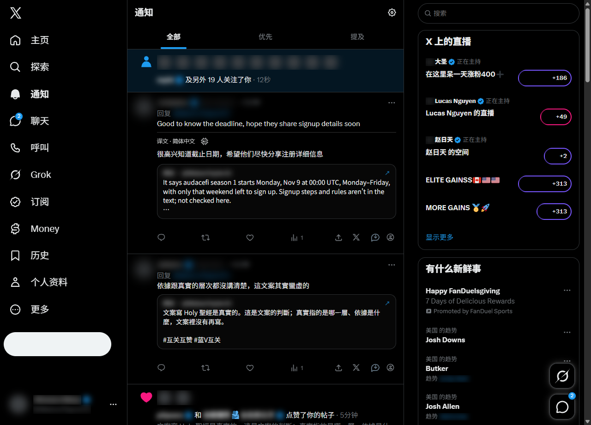

# X Notification Context

**See the original post directly under every reply in your X (Twitter) Notifications tab — no clicking back and forth.**

[](LICENSE)
[](#quick-install-1-minute)
[](#how-it-works--privacy)
[](https://goodexts.com)

When someone replies *"Agree!"*, *"Thanks!"*, or *"Follow back"* in `https://x.com/notifications`, X doesn't show which of your posts they are replying to. **X Notification Context** embeds a compact, clickable preview card of the original post right inside each reply notification.



---

## Quick Install (1 Minute)

1. Download the latest release ZIP: **[x-notification-context-v1.0.0.zip](https://github.com/wangsen2020/x-notification-context/releases/latest/download/x-notification-context-v1.0.0.zip)** and unzip it into a folder on your computer.
2. Open Chrome and navigate to `chrome://extensions/`.
3. Enable **Developer mode** (top right), click **Load unpacked**, and select the unzipped folder.
4. Open [x.com/notifications](https://x.com/notifications) — reply notifications now show the parent post right beneath them.

---

## How It Works & Privacy

The entire extension is ~400 lines of plain, auditable JavaScript with **zero external dependencies, zero analytics, and zero account cookie access**:

1. **Passive timeline listener ([`src/net-hook.js`](src/net-hook.js))**: Only listens to X's existing `NotificationsTimeline` GraphQL responses while you browse `/notifications`. It never modifies requests or reads auth headers.
2. **Local-first resolution ([`src/content.js`](src/content.js) & [`src/background.js`](src/background.js))**: Reuses post text already present in your notifications feed (e.g., likes/reposts) and caches resolved snippets locally in `chrome.storage.local` (capped at 500 entries).
3. **Zero-cookie public fallback ([`src/parser.js`](src/parser.js))**: If an older original post isn't in the timeline payload yet, the background worker fetches its public snippet from `api.fxtwitter.com` without sending your X session cookies. If unavailable (e.g., protected/deleted), it falls back to a direct status link.

### Minimal Permissions
- `"storage"` — caches up to 500 resolved post snippets locally so scrolling/reloading is instant.
- `"https://api.fxtwitter.com/*"` — fetches public text of parent tweets when X omits them from the notification payload.

---

## More X & Browser Extensions by [GoodExts](https://goodexts.com)

Built by **[GoodExts](https://goodexts.com)** — practical, local-first Chrome extensions and tools for X (Twitter) power users and indie builders. Explore all tools at **[goodexts.com](https://goodexts.com)**.

<table>
  <tr>
    <td width="50%" valign="top">
      <a href="https://xdown.goodexts.com">
        
      </a>
      <br />
      <strong>X Video Downloader</strong><br />
      One-click 1080p/720p X video &amp; GIF downloader with batch queue &amp; optional Google Drive sync.<br />
      <a href="https://xdown.goodexts.com">Website</a> · <a href="https://chromewebstore.google.com/detail/x-twitter-video-downloade/honcfokhpcchcffjhaahkcjiifkidolm">Chrome Web Store</a>
    </td>
    <td width="50%" valign="top">
      <a href="https://xexport.goodexts.com">
        
      </a>
      <br />
      <strong>XExport (X Article to PDF)</strong><br />
      Save X posts, threads, and Articles cleanly to PDF, Markdown, or Google Docs.<br />
      <a href="https://xexport.goodexts.com">Website</a> · <a href="https://chromewebstore.google.com/detail/x-article-to-pdf-export-x/akmedeebhjkchcpocceffimhpmfjimhn">Chrome Web Store</a>
    </td>
  </tr>
  <tr>
    <td width="50%" valign="top">
      <a href="https://xblocker.goodexts.com">
        
      </a>
      <br />
      <strong>X Blocker</strong><br />
      Auto-detect and bulk-clean spam replies, crypto bots, and unwanted accounts from your X feed.<br />
      <a href="https://xblocker.goodexts.com">Website</a> · <a href="https://chromewebstore.google.com/detail/x-blocker-auto-detect-bul/jlkifagakjajaamkgbjfplnegeggicni">Chrome Web Store</a>
    </td>
    <td width="50%" valign="top">
      <a href="https://goodexts.com/xzoom">
        
      </a>
      <br />
      <strong>XZoom</strong><br />
      Inspect X images in original uncompressed resolution with smooth mouse-wheel zoom &amp; pan.<br />
      <a href="https://goodexts.com/xzoom">Website</a> · <a href="https://github.com/wangsen2020/xzoom">GitHub</a>
    </td>
  </tr>
  <tr>
    <td width="50%" valign="top">
      <a href="https://goodexts.com/x-chat-translator">
        
      </a>
      <br />
      <strong>XTrans (X Chat Translator)</strong><br />
      Translate X posts, DMs, Articles, and live reply drafts inline across multiple AI engines.<br />
      <a href="https://goodexts.com/x-chat-translator">Website</a> · <a href="https://chromewebstore.google.com/detail/x-chat-translator/dlijcpgpcmbnenmhpgijjhlhedhkmbmk">Chrome Web Store</a>
    </td>
    <td width="50%" valign="top">
      <a href="https://goodexts.com/xfollower">
        
      </a>
      <br />
      <strong>XFollower</strong><br />
      X account growth &amp; relationship suite: notification monitoring, smart follow queues, and AI engagement.<br />
      <a href="https://goodexts.com/xfollower">Website</a> · <a href="https://chromewebstore.google.com/detail/xfollower-follower-manage/dbokihddfeclflabcnjggminlkdfjfjf">Chrome Web Store</a>
    </td>
  </tr>
</table>

---

## Development

```bash
npm test   # Run parser & FxTwitter client unit tests
npm run pack  # Build dist/x-notification-context-v1.0.0.zip
```

## License

[MIT](LICENSE)
